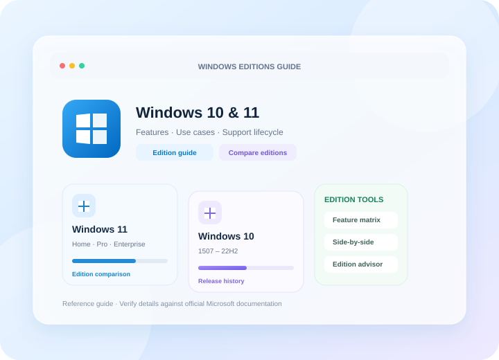

# Windows Editions Guide

  

  <strong>Understand the differences. Choose the right Windows edition.</strong> 
  A bilingual reference guide to Windows 10 and Windows 11 editions, features, use cases, and support lifecycles.

  <a href="https://r3v01nter.github.io/windows-editions/">Open the live guide</a>

---

## 中文介绍

**Windows Editions Guide（Windows 版本指南）** 是一个面向 Windows 10 和 Windows 11 的交互式版本参考工具，帮助用户了解不同版本的功能差异、产品定位、适用场景与生命周期信息。

### 你可以在这里

- **查看版本详情**：了解 Home、Pro、Enterprise、Education、LTSC 等版本类别的主要定位。
- **并排比较版本**：通过卡片视图快速浏览所选版本的特点。
- **检查功能差异**：使用功能矩阵对比常见功能与管理能力。
- **回顾版本历史**：查看 Windows 版本演进与支持状态相关信息。
- **辅助版本选择**：通过选型向导，根据需求缩小选择范围。
- **切换语言与主题**：支持中文 / English，以及浅色、深色和跟随系统主题。

### 项目原则

- 优先参考 Microsoft 官方文档与生命周期资料。
- 明确区分版本功能、许可条件与支持状态；具体能力可能因版本、设备、许可和部署方式而异。
- 将复杂的版本信息整理成更容易浏览和比较的界面。

> **注意：** 本项目是独立的参考工具，并非 Microsoft 官方产品。版本功能、系统要求和支持状态可能变化；请以 Microsoft 最新官方资料及实际许可条款为准。

## English

**Windows Editions Guide** is an interactive reference for Windows 10 and Windows 11. It helps users understand edition differences, intended use, feature availability, and support lifecycle information.

### What it offers

- **Edition details** — Review the positioning and key characteristics of editions such as Home, Pro, Enterprise, Education, and LTSC.
- **Side-by-side comparison** — Browse selected editions in a card-based view.
- **Feature matrix** — Compare common features and management capabilities across editions.
- **Release history** — Explore Windows version milestones and related support information.
- **Edition advisor** — Narrow down edition options based on your needs.
- **Bilingual interface and themes** — Switch between Chinese and English, with light, dark, and system theme options.

### Project principles

- Prefer Microsoft documentation and official lifecycle information as reference sources.
- Distinguish edition features from licensing requirements and support status; availability can vary by version, device, license, and deployment.
- Present complex edition information in a format that is easier to explore and compare.

> **Disclaimer:** This is an independent reference project, not an official Microsoft product. Features, system requirements, and support status can change. Always consult the latest Microsoft documentation and applicable license terms.

## Links

- **Live website:** https://r3v01nter.github.io/windows-editions/
- **Source code:** https://github.com/r3v01nter/windows-editions
